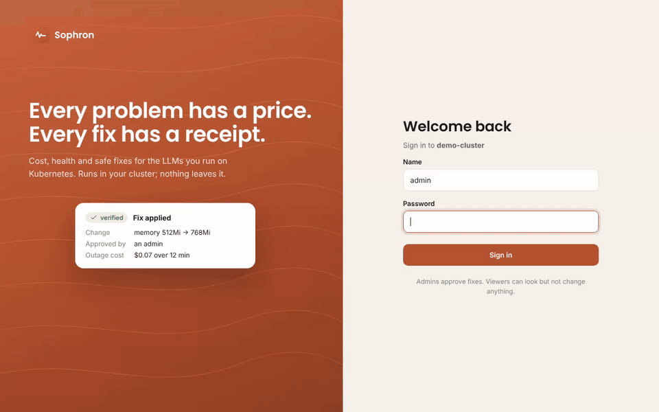
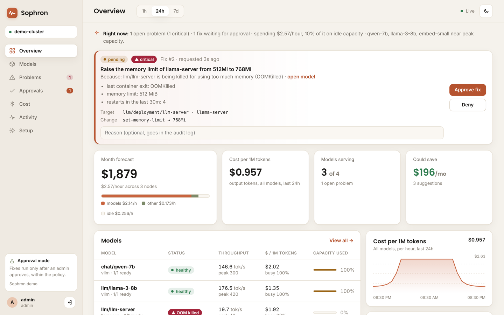
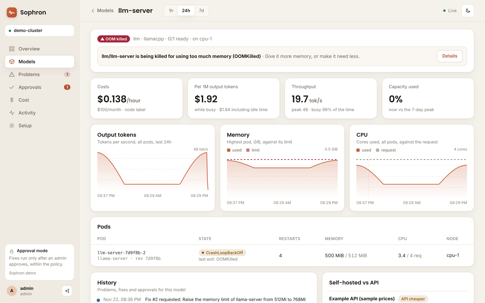
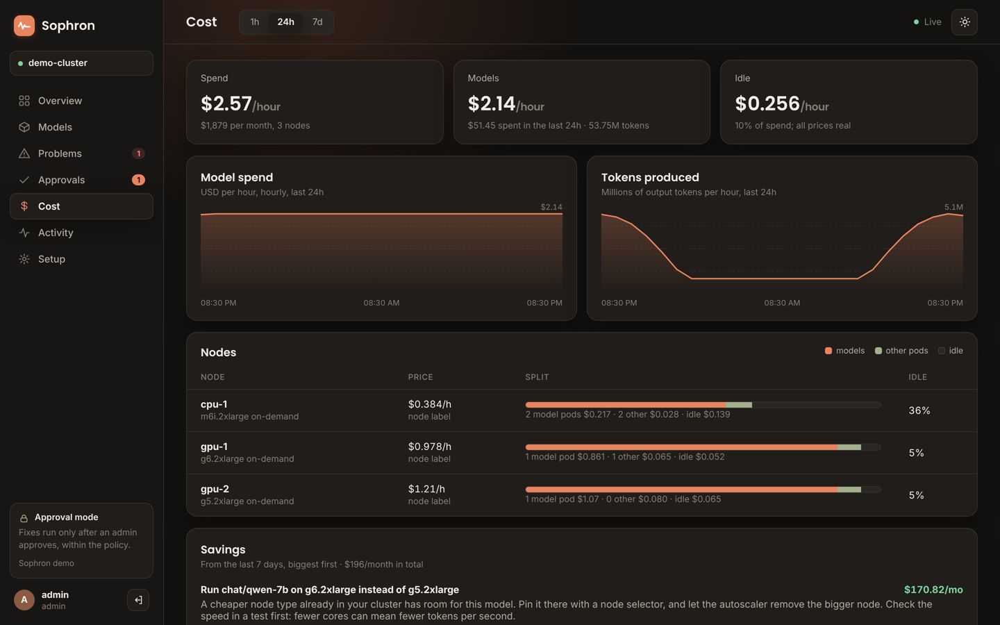

# Sophron

Prudent operations for self-hosted LLMs on Kubernetes.

*Sophron* (σώφρων) is Greek for "prudent". Kubernetes is the helmsman that steers your workloads. Sophron keeps your self-hosted LLMs cheap, healthy and safe to change.

> Status: **v0.1.2**. Tested end to end in the lab: 6 detectors, Slack alerts with Approve/Deny buttons, cost per model and per 1M tokens, savings, fixes with policy + approval + a hash-chained audit log, and a dashboard.



## Quickstart

You need a Kubernetes cluster (EKS, AKS, GKE, kind, anything) with Prometheus (for example [kube-prometheus-stack](https://github.com/prometheus-community/helm-charts/tree/main/charts/kube-prometheus-stack)) and a model server that exposes metrics (vLLM, llama.cpp with `--metrics`), or any pod labelled `sophron.dev/model-server`.

```bash
# 1. Install. One pod: collector, detectors, cost engine, fixes, dashboard.
helm install sophron oci://ghcr.io/shiva-2103/charts/sophron --version 0.1.2 \
  --namespace sophron --create-namespace \
  --set clusterName=my-cluster --set 'policy.namespaces={llm}'

# 2. Read the generated admin password
kubectl -n sophron get secret sophron-admin -o jsonpath='{.data.password}' | base64 -d; echo

# 3. Open the dashboard at http://localhost:8081 and sign in as admin
kubectl -n sophron port-forward svc/sophron 8081:8080
```

No login to any registry and no Slack needed. Then open **Setup**: it checks Prometheus, token and container metrics, prices, Slack, sign-in and fix permissions, and tells you the fix for anything missing.

### Slack (optional, any time)

Without Slack, everything works in the dashboard. To get alerts, and Approve/Deny buttons in Slack, put your Slack app's secrets in a Secret, then point the chart at it:

```bash
# Alerts: the app's incoming webhook URL (typed at a hidden prompt, never in your shell history)
read -rsp "Slack webhook URL: " HOOK; echo
# Buttons (optional): an app-level token xapp-... with connections:write, Socket Mode and Interactivity on
read -rsp "Slack app token (Enter to skip): " APPTOKEN; echo
kubectl -n sophron create secret generic sophron-slack \
  --from-literal=webhook-url="$HOOK" ${APPTOKEN:+--from-literal=app-token="$APPTOKEN"}
unset HOOK APPTOKEN

# Turn it on; approvers are the Slack member IDs allowed to press Approve/Deny
helm upgrade sophron oci://ghcr.io/shiva-2103/charts/sophron --version 0.1.2 -n sophron --reuse-values \
  --set slack.existingSecret=sophron-slack --set 'slack.approvers={U0123ABCD}'
kubectl -n sophron rollout restart deploy/sophron   # Slack secrets are read at start
```

Leave out the app token and the approvers, and you get alerts with a link to the dashboard instead of buttons. To turn Slack off, delete the Secret and restart the same way; nothing else changes.

| Setting | Default | Example |
|---|---|---|
| `clusterName` | `kubernetes` | shown in alerts and the dashboard |
| `prometheus.url` | `http://prometheus-operated.monitoring.svc:9090` | your Prometheus service |
| `policy.namespaces` | none: fixes blocked everywhere | `{llm,chat}` |
| `policy.default` | `approve` | `never` for read-only, `auto` per action |
| `pricing.nodes` | node label, then OpenCost, then estimates | `[{name: "gpu-*", hourly: 0.8048}]` |
| `slack.existingSecret` / `slack.approvers` | off | `sophron-slack` / `{U0123ABCD}` |
| `auth.existingSecret` | generated | your own Secret with `password`, `viewer-password` |
| `timezone` | `UTC` | `Asia/Kolkata` |

All settings: [`charts/sophron/values.yaml`](charts/sophron/values.yaml).

No cluster? `make demo` runs the real dashboard on a day of sample data at http://localhost:8090 (admin / demo-password-1; needs Go).

| Overview | One model | Cost (dark) |
|---|---|---|
|  |  |  |


## The problem

Teams running their own LLMs on Kubernetes keep asking three questions:

| Question | Today |
|---|---|
| What does this cost? | Nobody knows the cost per request or which GPUs sit idle |
| Why did it break? | The same failures repeat, and every team debugs them from scratch |
| Is this change safe? | Model and config changes are "deploy and hope" |

## What Sophron does

- **Shows the cost:** per model, per 1M tokens (average and while busy), idle capacity, compared with APIs you choose
- **Suggests savings:** right-size requests, idle models and nodes, cheaper node types already in your cluster
- **Finds failures:** OOM kills, crash loops, stuck rollouts, unschedulable pods, slow starts, queue backlog, explained in plain words with a ready fix
- **Fixes safely:** only after your policy and a named admin approve, in the dashboard or in Slack; every step in a tamper-evident audit log, and a receipt when it's resolved
- **Tests changes** (later): new model versions get a small share of traffic first

## Promises

- Runs entirely in your cluster. One Helm chart. No data leaves.
- Read-only until you turn fixes on.
- Works without AI. An LLM is optional, only for explanations.
- Uses what you already run: Prometheus, Grafana, Slack.

## Docs

| Read this | To learn |
|---|---|
| [Architecture](docs/ARCHITECTURE.md) | How each part works |
| [Roadmap](docs/ROADMAP.md) | What we build, phase by phase |
| [Workflow](docs/WORKFLOW.md) | Branches, commits and PRs |
| [Learning notes](docs/learning/) | What we built, how, and why |

## License

Apache 2.0
