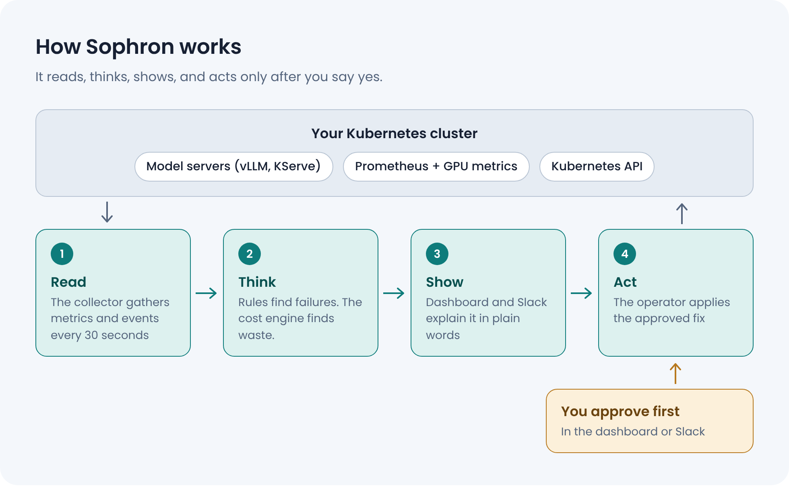

# Sophron

Prudent operations for self-hosted LLMs on Kubernetes.

*Sophron* (σώφρων) is Greek for "prudent". Kubernetes is the helmsman that steers your workloads. Sophron keeps your self-hosted LLMs cheap, healthy and safe to change.

> Status: building. Phase 1 (lab cluster) and Phase 2 (collector) work. Next: Phase 3, the rules engine.

## The problem

Teams running their own LLMs on Kubernetes keep asking three questions:

| Question | Today |
|---|---|
| What does this cost? | Nobody knows the cost per request or which GPUs sit idle |
| Why did it break? | The same failures repeat, and every team debugs them from scratch |
| Is this change safe? | Model and config changes are "deploy and hope" |

## What Sophron does

- **Shows the cost:** per model, per 1,000 tokens, idle GPUs, cheaper node suggestions
- **Finds failures:** known LLM-serving problems, explained in plain words with a ready fix
- **Fixes safely:** only after your policy and a human approve
- **Tests changes** (later): new model versions get a small share of traffic first

## Promises

- Runs entirely in your cluster. One Helm chart. No data leaves.
- Read-only until you turn fixes on.
- Works without AI. An LLM is optional, only for explanations.
- Uses what you already run: Prometheus, Grafana, Slack.

## Docs

| Read this | To learn |
|---|---|
| [Architecture](docs/ARCHITECTURE.md) | How each part works |
| [Roadmap](docs/ROADMAP.md) | What we build, phase by phase |
| [Workflow](docs/WORKFLOW.md) | Branches, commits and PRs |
| [Learning notes](docs/learning/) | What we built, how, and why |

## License

Apache 2.0
