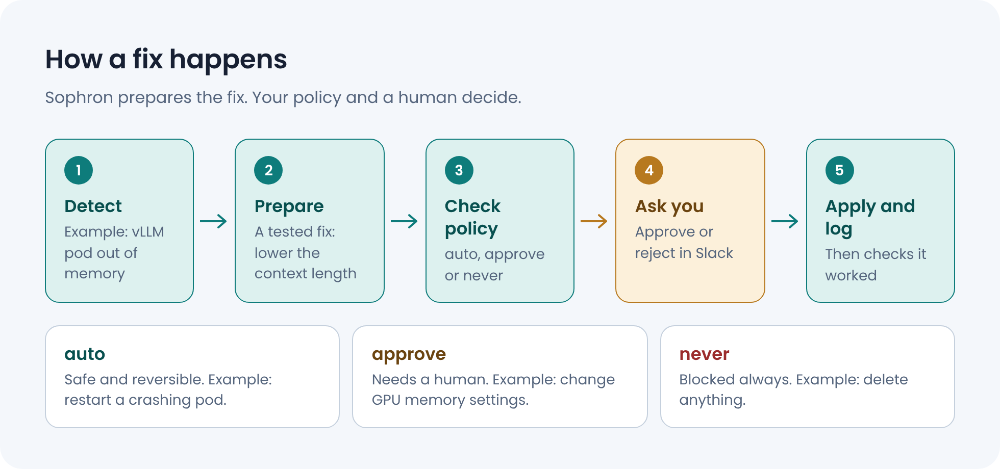

# Architecture


Sophron works in four steps: **read, think, show, act**. It never acts without approval.

## The parts

### 1. Collector

Reads what your cluster already reports.

- Asks Prometheus for GPU use, tokens per second, queue length and KV cache usage
- Watches Kubernetes for pods, nodes, restarts and errors
- Saves one clean snapshot per model every 30 to 60 seconds

Think of it as a meter reader who checks every meter on a schedule.

Built with: Go, `client-go`, Prometheus API

### 2. Store

Keeps snapshots, problems found, proposed fixes and the audit log.

- SQLite by default, so there's nothing to set up
- Postgres for larger clusters

### 3. Rules engine

Finds known problems. Each rule (a "detector") looks for one failure:

| Detector | Notices | Suggests |
|---|---|---|
| `pending-unschedulable` | Pod has no node: no GPU, CPU or memory room, or no matching node | The fix for that cause, for example a lower CPU request |
| `rollout-stuck` | New version not Ready while the old one still serves | `maxSurge: 0` / `Recreate`, or `rollout undo` |
| `oom-killed` | Container killed for using too much memory | A new memory limit, or a smaller `--ctx-size` |
| `container-failing` | Crash loop, image pull or container create errors | The log command and the usual LLM causes |
| `slow-cold-start` | Pod takes 2+ minutes to become Ready | Keep the model on a volume, pre-pull images |
| `queue-backlog` | Requests keep waiting for a free slot | More slots, or more capacity if the CPU/GPU is already busy |

Planned once we test on GPUs and vLLM: `kv-cache-pressure`, `gpu-idle`.

Each finding has a title, plain-English summary, evidence and a suggested fix. It stays open while the problem lasts and resolves 90 seconds after it's gone. See [the Phase 3 learning note](learning/03-phase-3-rules-engine.md).

New, escalated and resolved findings go to Slack (`internal/notify`): a coloured card with the facts, evidence and fix. Warning and above by default, a 10-minute cooldown for problems that come back, retries that respect Slack's rate limit. The webhook URL lives in a Kubernetes Secret and is never logged.

Why rules, not AI? Rules are free, work offline, can be tested, and never invent a risky action.

Built with: Go, unit tests, plus chaos scenarios that trigger each failure on purpose (`make rules-check`)

### 4. Cost engine

Answers "what does this cost, and what should it run on?"

- Prices each node: a node label, your price file (cloud or owned hardware), [OpenCost](https://www.opencost.io)'s prices if installed, or default prices marked as an estimate
- Splits the price per CPU core, GiB and GPU; each pod pays the larger of reserved and used
- Reports cost per model per hour, month and 1M tokens; idle cost per node; down cost of each finding
- Compares self-hosting with hosted APIs you choose, with the break-even volume
- Next: checks if a model fits on a cheaper node, and gives you the YAML change

See [the Phase 4 learning note](learning/04-phase-4-cost-engine.md).

Sophron suggests node changes. Your autoscaler (Karpenter or Cluster Autoscaler) does the actual work.

### 5. API and dashboard

Shows everything in one place: overview, cost, endpoints, problems, approvals, audit log and setup health.

Built with: Go API, React dashboard, served inside your cluster

### 6. Operator

Applies a fix only when your policy allows it.



Your rules live in a `RemediationPolicy`, a Kubernetes resource you control. Every action is written to the audit log.

Built with: Kubebuilder, custom resources, Slack buttons

### 7. LLM explanations (optional)

The rules already know what's wrong. An LLM only explains it in plain English. Pick one:

| Option | Runs on | Best for |
|---|---|---|
| None (default) | Pre-written explanations | Everyone, free, offline |
| Small bundled model | Your CPU | No API key, data stays inside |
| Your API key | OpenAI, Anthropic, Gemini | Best explanations |
| Your own endpoint | Your vLLM | Self-hosters |

The LLM never chooses actions. Actions come only from tested fixes.

### 8. Safe rollouts (later)

A new model version gets a small slice of traffic. Sophron runs your test prompts on old and new, compares quality and speed, then promotes or rolls back.

Built with: Argo Rollouts analysis

## Folder layout

```text
sophron/
├── cmd/            # programs: CLI, collector, api, operator
├── internal/       # collector, store, rules, cost, notify, explain
├── api/v1alpha1/   # custom resource types
├── charts/sophron/ # Helm chart
├── web/            # dashboard
├── lab/            # local test cluster and failure scenarios
└── docs/           # these docs
```

## Tech choices

| Choice | Why |
|---|---|
| Go | Standard for Kubernetes tools, small and fast |
| Kubebuilder | Standard way to build operators |
| SQLite, then Postgres | Zero setup, scales later |
| React | Widely known |
| Helm | Every Kubernetes user has it |
| kind or k3s for testing | Free, runs on a laptop |
