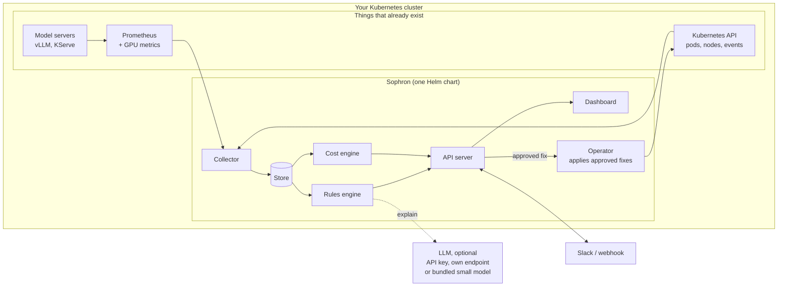

# Sophron architecture

This page explains how Sophron works, one part at a time, in plain language. Each part has a "think of it as" line, what it does, and what it's built with.

## The big picture



**In one sentence:** Sophron *reads* what your cluster and model servers are already reporting, *works out* cost and problems, *shows* them in a dashboard, and *changes* things only when a human approves.

The flow has four stages: **Read → Think → Show → Act (with approval)**.

---

## 1. Read: the Collector

**Think of it as:** a meter reader who walks around the building every 30 seconds and writes down every meter.

**What it does**
- Asks **Prometheus** for numbers: GPU utilization and memory (from NVIDIA's DCGM exporter), and vLLM metrics like tokens per second, queue length and KV cache usage.
- Watches the **Kubernetes API** for facts: which pods run where, node types and labels, restarts, `OOMKilled`, `Pending` pods and events.
- Joins both into one simple record per model endpoint, every 30–60 seconds, and saves it in the Store.

**Why a separate collector?** Every other part reads clean, ready-made data instead of talking to Prometheus and Kubernetes directly. If a metric name changes, we fix it in one place.

**Built with:** Go, `client-go` (the official Kubernetes client), the Prometheus HTTP API.

---

## 2. Remember: the Store

**Think of it as:** the notebook the meter reader writes in.

**What it does:** keeps snapshots, detected incidents, proposed fixes and the audit log.

**Built with:** SQLite by default (zero setup), Postgres optionally for larger clusters. We keep aggregated data, not raw metrics, so it stays small.

---

## 3. Think: the Rules engine (the SRE brain)

**Think of it as:** an experienced SRE's checklist, turned into code.

**What it does:** runs a set of **detectors** on each new snapshot. Each detector looks for one known failure, for example:

| Detector | What it notices | Example finding |
|---|---|---|
| `oom-context-length` | vLLM pod `OOMKilled` and its `max-model-len` is too big for the GPU | "Lower max-model-len from 32768 to 8192" |
| `kv-cache-pressure` | KV cache above 95% and requests queuing | "Add a replica or reduce max-num-seqs" |
| `gpu-idle` | GPU under 10% use for 6+ hours | "This GPU costs ₹X/day and is mostly idle" |
| `pending-no-gpu` | Pod `Pending` because no node has a free GPU | "No GPU node available; check node pool / autoscaler" |
| `slow-cold-start` | Pod takes 10+ minutes to become ready | "Model download is slow; cache the model on a volume" |

Each finding comes with **evidence** (the metrics and events that triggered it) and a **fix template** (the exact change to make).

**Why rules first, not AI?** Rules are free, offline, testable, and never invent a dangerous action. LLM-serving failures are a known, finite set, so rules cover most real cases.

**Built with:** Go. Each detector is a small function with its own unit tests and a "chaos scenario" that reproduces the failure in a test cluster.

---

## 4. Think: the Cost engine

**Think of it as:** an accountant who knows the price of every machine.

**What it does**
- Gets the **price per hour** of each node: public cloud pricing APIs (AWS, GCP, Azure) cached daily, or prices you type in for on-prem.
- Uses **OpenCost** (a CNCF project) for basic Kubernetes cost allocation, so we don't rebuild what already exists.
- Adds the **LLM layer** on top: cost per model, cost per 1,000 tokens, idle GPU cost.
- **Node fit:** estimates how much GPU memory a model really needs (weights + KV cache + overhead) and compares it with cheaper node types. Output: "this model fits on an L4 instead of an A100, about 60% cheaper", plus the YAML change.

**Important boundary:** Sophron *recommends* node changes; your autoscaler (Karpenter, Cluster Autoscaler) does the actual provisioning.

**Built with:** Go, OpenCost API, cloud pricing APIs.

---

## 5. Show: the API server and Dashboard

**Think of it as:** the control room screen.

**What it does:** the API server serves everything as JSON; the dashboard shows it. Main pages: Overview, Cost, Node fit, Endpoints, Incidents, Approvals, Audit log, Setup health, Settings.

**Built with:** Go API server, React dashboard, served from inside the cluster (port-forward or your Ingress). No external cloud.

---

## 6. Act (with approval): Policies, approvals and the Operator

**Think of it as:** a junior engineer who prepares the fix, and a senior who must sign before it goes live.

**How a fix flows**
1. Rules engine finds a problem and prepares a fix.
2. The fix is checked against your **`RemediationPolicy`** (a Kubernetes custom resource you control):
   - `auto`: allowed without asking (example: restart a crash-looping pod)
   - `approve`: needs a human (example: change GPU memory settings)
   - `never`: not allowed at all (example: delete anything)
3. If approval is needed, Sophron posts it to the dashboard and Slack with **Approve / Reject** buttons and a diff of the change.
4. On approval, the **Operator** applies it and watches the result.
5. Everything is written to the **audit log**: who approved, what changed, did it help.

**Built with:** Kubebuilder (the standard Go framework for Kubernetes operators), Custom Resource Definitions, Slack interactive messages.

---

## 7. Explain (optional): the LLM tiers

The rules engine already *knows* what's wrong. An LLM only helps *explain* it in plain English or dig into unusual cases. Users pick one:

| Tier | Uses | Good for |
|---|---|---|
| 0. None (default) | Rules + pre-written explanations | Everyone, offline, free |
| 1. Bundled small model | 1–3B model on CPU (llama.cpp) | No API key, data must stay inside |
| 2. Your API key | OpenAI, Anthropic, Gemini… | Best explanations |
| 3. Your own endpoint | Your own vLLM / any OpenAI-compatible URL | Self-hosters, no data leaves |

**Safety rule:** the model never chooses actions. Actions only come from tested fix templates, checked against your policy.

---

## 8. Change safely (later): Safe rollouts

**Think of it as:** a taste test before serving the whole restaurant.

A `ModelRollout` resource sends a small share of traffic to the new model version, runs your eval prompts on both, compares quality, latency and tokens/sec, and promotes or rolls back automatically. Built on Argo Rollouts' analysis feature.

---

## Planned repository layout

```text
sophron/
├── cmd/                  # entry points: sophron (CLI), collector, api, operator
├── internal/
│   ├── collector/        # reads Prometheus + Kubernetes
│   ├── store/            # SQLite / Postgres
│   ├── rules/            # detectors + fix templates
│   ├── cost/             # pricing, OpenCost, node fit
│   ├── notify/           # Slack / webhook
│   └── explain/          # optional LLM tiers
├── api/v1alpha1/         # CRD types: RemediationPolicy, ModelRollout
├── charts/sophron/       # the Helm chart
├── web/                  # React dashboard
├── lab/                  # local test cluster, demo models, chaos scenarios
├── docs/                 # architecture, roadmap, learning notes
└── .github/workflows/    # CI
```

## Tech choices at a glance

| Choice | Why |
|---|---|
| **Go** for backend | Kubernetes ecosystem standard, small memory use, single binaries |
| **Kubebuilder** for the operator | Standard way to build CRDs and controllers |
| **SQLite → Postgres** | Zero-setup default, scales when needed |
| **React** for the dashboard | Widely known, huge ecosystem |
| **Helm** for install | What every Kubernetes user already uses |
| **kind / k3s** for the lab | Free, runs on a laptop, CPU-only models for development |
