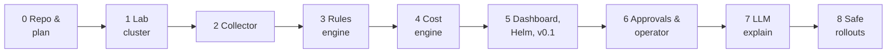

# Sophron roadmap

We build Sophron **brick by brick**. Each phase:
- ends with something that **runs** and can be demoed,
- has a clear **done when** checklist,
- comes with a **learning note** in `docs/learning/` (what we built, how, why, how it fits Sophron, and a real-world example).

Rough timeline assumes side-project hours (about 8–10 hours a week).

---

## Phase 0: Repo and plan (week 1)

**Goal:** a clean, professional open-source repo with the plan written down.

**Build**
- GitHub repo with Apache-2.0 license, README, `.gitignore`
- `plan` branch with architecture, roadmap and workflow docs → PR to `main`
- GitHub Project board with one column per phase
- Branch protection on `main`

**Done when**
- [ ] Repo is public and `main` is protected
- [ ] Planning PR merged
- [ ] Project board has Phase 1 tasks as issues

**You learn:** open-source repo hygiene, docs-as-code, PR-based workflow.

---

## Phase 1: Lab cluster with a real model (weeks 2–3)

**Goal:** a laptop Kubernetes cluster that serves a small LLM and exposes the metrics Sophron will read.

**Build** (in `lab/`)
- kind cluster config + a `make lab-up` / `make lab-down`
- A small model served on CPU (vLLM CPU build or Ollama/llama.cpp with an OpenAI-compatible API)
- kube-prometheus-stack installed and scraping the model server
- A load generator script to send requests
- Notes for GPU mode (DCGM exporter) for later cloud tests

**Done when**
- [ ] `make lab-up` gives a working cluster in one command
- [ ] You can query the model with `curl`
- [ ] Prometheus shows tokens/sec, latency and queue metrics

**You learn:** how vLLM serves models (KV cache, batching, context length vs memory), Prometheus scraping, PromQL basics.

---

## Phase 2: Collector (weeks 4–6)

**Goal:** Sophron's first code: read the cluster and save clean snapshots.

**Build**
- Go module, `cmd/collector`, `internal/collector`, `internal/store` (SQLite)
- Kubernetes watcher using informers (pods, nodes, events)
- Prometheus client with a metric mapping file (vLLM first)
- A snapshot per endpoint every 30–60s
- Unit tests + CI (GitHub Actions: lint, test, build image)

**Done when**
- [ ] Collector runs in the lab cluster as a pod
- [ ] `sqlite3` shows fresh snapshots with GPU/CPU, tokens/sec, restarts
- [ ] CI is green on every PR

**You learn:** Go project structure, `client-go` and informers, RBAC (least privilege), PromQL from code, writing a Dockerfile for Go.

---

## Phase 3: Rules engine (weeks 7–9)

**Goal:** detect real LLM-serving failures and explain them.

**Build**
- Detector interface + first 5 detectors (OOM from context length, KV cache pressure, GPU idle, Pending for no GPU, slow cold start)
- Fix templates (the exact YAML change)
- Chaos scenarios in `lab/chaos/` that reproduce each failure on purpose
- Notifications: Slack webhook / generic webhook (read-only, no buttons yet)

**Done when**
- [ ] Each chaos scenario triggers the right detector within 2 minutes
- [ ] Slack receives a clear message with evidence and the suggested fix
- [ ] Each detector has unit tests

**You learn:** how SRE teams codify runbooks, chaos testing, designing alerts that aren't noisy.

---

## Phase 4: Cost engine (weeks 10–12)

**Goal:** answer "what does this cost and what should it run on?"

**Build**
- Pricing: cloud pricing API snapshot + manual price config for on-prem
- OpenCost integration for base allocation
- Cost per model, cost per 1,000 tokens, idle GPU cost
- Node-fit estimator (weights + KV cache + overhead vs GPU memory catalog)

**Done when**
- [ ] Lab shows cost per model using configured prices
- [ ] Node-fit gives a sensible suggestion for 3 test models (checked by hand)

**You learn:** FinOps for Kubernetes, how GPU memory for LLMs is calculated, quantization trade-offs.

---

## Phase 5: Dashboard, Helm chart, doctor → release v0.1 (weeks 13–16)

**Goal:** something strangers can install and use.

**Build**
- API server (`cmd/api`)
- React dashboard: Overview, Cost, Endpoints, Incidents, Setup health
- Helm chart with zero required values; reuse existing Prometheus if found
- `sophron doctor` CLI: detects cluster type, missing components, RBAC issues
- Install tested in CI on kind and k3s; manual test on one managed cloud cluster
- Docs site basics, demo video, **v0.1.0 release**
- Post on r/kubernetes, r/LocalLLaMA, CNCF Slack

**Done when**
- [ ] `helm install` works on a fresh cluster with no values
- [ ] `sophron doctor` explains every missing piece
- [ ] First 10 people outside us have tried it

**You learn:** Helm chart design, release engineering (tags, signed images, changelog), building in public.

---

## Phase 6: Approvals and the operator (weeks 17–20)

**Goal:** fix things safely, with a human in the loop.

**Build**
- Kubebuilder operator, `RemediationPolicy` CRD (`auto` / `approve` / `never`)
- Slack interactive Approve / Reject buttons; same in the dashboard
- Apply approved fixes, verify the result, audit log page

**Done when**
- [ ] A chaos scenario → Slack approval → fix applied → problem gone, all logged
- [ ] A `never` action is impossible even if someone tries

**You learn:** operators and CRDs, reconcile loops, safe automation design.

---

## Phase 7: LLM explain tiers (weeks 21–22)

**Goal:** plain-English explanations for everyone.

**Build:** provider interface; tier 2 (API key) and tier 3 (own endpoint) first; tier 1 bundled small model on CPU; evaluation set comparing explanation quality.

**You learn:** LLM integration, prompt design, evaluating LLM output, running small models on CPU.

---

## Phase 8: Safe rollouts (weeks 23–26)

**Goal:** model changes that test themselves.

**Build:** `ModelRollout` CRD, Argo Rollouts analysis, eval job comparing old vs new (quality, latency, tokens/sec), auto promote / rollback.

**You learn:** canary analysis for ML, LLM evaluation, progressive delivery.

---

## Later (stretch)

- Fine-tune a small diagnosis model with data from our chaos scenarios (LoRA), and compare it with large API models
- More model servers: TGI, Triton, SGLang
- Multi-cluster view
- Contribute detectors or integrations upstream (HolmesGPT, OpenCost)
