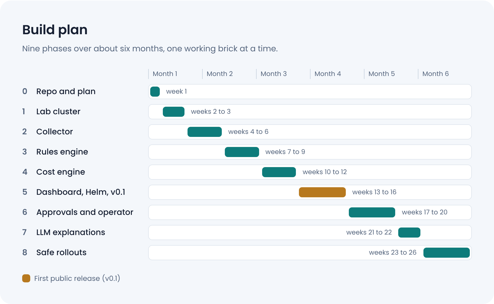

# Roadmap

We build Sophron one working brick at a time. Each phase:

- ends with something you can run and demo
- has a "done when" checklist
- gets a learning note in [`docs/learning/`](learning/)

Timing assumes 8 to 10 hours a week.

## Phase 0: Repo and plan

Week 1

- [ ] Repo with license, README and docs
- [ ] Plan merged into `main`
- [ ] Project board with Phase 1 issues

Learn: open-source repo setup, working with pull requests

## Phase 1: Lab cluster

Weeks 2 to 3. A laptop cluster serving a small model.

- [x] `make lab-up` starts a kind cluster in one command
- [x] A small model answers `curl` requests
- [x] Prometheus shows tokens per second and CPU use

Learn: how vLLM serves models, KV cache, Prometheus and PromQL

## Phase 2: Collector

Weeks 4 to 6. Sophron's first code.

- [x] Collector runs as a pod in the lab (`make collector-up`)
- [x] Snapshots join Prometheus metrics with pod, node and event facts
- [x] Labelled pods are tracked even while Pending
- [x] Read-only RBAC, non-root, read-only filesystem
- [x] CI runs tidy, format, vet, lint, race tests, image build and manifest checks
- [ ] `make collector-check` passes in the lab

Learn: Go project layout, `client-go` informers, RBAC, PromQL from code, Docker multi-stage builds

## Phase 3: Rules engine

Weeks 7 to 9. Detect real failures.

- [ ] First 5 detectors with tests
- [ ] A test scenario for each failure
- [ ] Slack message with evidence and the suggested fix

Learn: turning runbooks into code, chaos testing, alerts that aren't noisy

## Phase 4: Cost engine

Weeks 10 to 12. What it costs and where it should run.

- [ ] Cost per model and per 1,000 tokens
- [ ] Node-fit suggestions, checked by hand for 3 models

Learn: Kubernetes FinOps, GPU memory math, quantization

## Phase 5: Dashboard and first release

Weeks 13 to 16. Something strangers can install.

- [ ] `helm install` works with no settings
- [ ] `sophron doctor` explains anything missing
- [ ] Dashboard: overview, cost, endpoints, problems, setup health
- [ ] Release v0.1.0 and share it
- [ ] 10 people outside us have tried it

Learn: Helm chart design, releases, building in public

## Phase 6: Approvals and operator

Weeks 17 to 20. Fix things with a human in the loop.

- [ ] `RemediationPolicy` with auto, approve and never
- [ ] Approve or reject from Slack and the dashboard
- [ ] Audit log page
- [ ] A "never" action can't run, whatever happens

Learn: operators, custom resources, safe automation

## Phase 7: LLM explanations

Weeks 21 to 22.

- [ ] Your API key or your own endpoint
- [ ] Small model on CPU
- [ ] A test set to compare explanation quality

Learn: LLM integration, prompts, evaluating LLM output

## Phase 8: Safe rollouts

Weeks 23 to 26.

- [ ] `ModelRollout` resource
- [ ] Compare old and new on your test prompts
- [ ] Promote or roll back automatically

Learn: canary releases for models, LLM evaluation

## Later

- Train a small diagnosis model on our failure data
- Support more model servers: TGI, Triton, SGLang
- View many clusters in one place
- Contribute back to HolmesGPT and OpenCost
