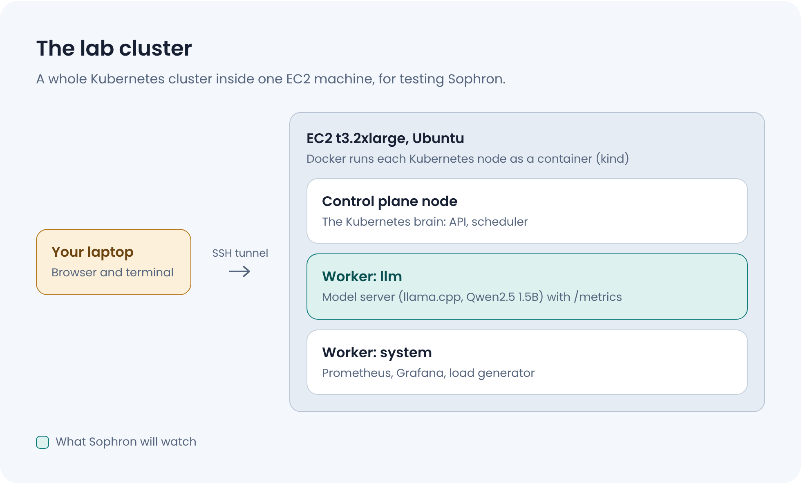

# Phase 1: Lab cluster

## What we built

| Piece | File |
|---|---|
| Tool installer for Ubuntu | `lab/scripts/bootstrap-ubuntu.sh` |
| 3-node kind cluster | `lab/kind/cluster.yaml` |
| Prometheus + Grafana settings | `lab/monitoring/values.yaml` |
| Model server + metrics scraping | `lab/llm/model-server.yaml` |
| Load generator | `lab/loadgen/job.yaml` |
| One-command workflow | `Makefile` |
| Automatic checks | `lab/scripts/check.sh` |

## How it works

1. **kind** starts 3 Docker containers. Each one acts as a Kubernetes node.
2. One worker gets the label `sophron.dev/role=llm`. The model server's `nodeSelector` sends it there, just like a GPU node pool in a real cluster.
3. An **init container** downloads the model file once into a volume. The main container starts only after it finishes.
4. **llama-server** loads the model and serves an OpenAI-style API on port 8080. The `--metrics` flag adds `/metrics`.
5. A **ServiceMonitor** tells Prometheus: scrape `llm-server`'s `/metrics` every 15 seconds.
6. The **load generator** sends chat requests, so the numbers move.
7. `make lab-check` asks Prometheus for those numbers and prints PASS or FAIL.

## Key ideas

### kind vs minikube vs k3s

| Tool | Runs as | Best for |
|---|---|---|
| kind | Nodes are Docker containers | Throwaway clusters and CI |
| minikube | One VM or container | Learning on a laptop |
| k3s | Lightweight real Kubernetes | Small servers, edge |

We use kind because the lab must be disposable, and the same cluster will run in GitHub Actions to test Sophron.

### Init containers

Run to completion before the main container starts. Good for one-time setup like downloading a model. A slow download here is a real-world problem, and later Sophron's `slow-cold-start` detector will spot it.

### Probes

| Probe | Question it answers | If it fails |
|---|---|---|
| startup | Has the app finished starting? | Waits, then restarts |
| readiness | Can it take traffic now? | Removed from the Service |
| liveness | Is it still alive? | Restarted |

Our startup probe allows 5 minutes, because loading a model is slow.

### What llama.cpp settings mean

| Flag | Meaning |
|---|---|
| `--ctx-size 8192` | Total context (KV cache) shared by all requests |
| `--parallel 4` | Up to 4 requests at once. Each gets 8192 / 4 = 2048 tokens |
| `--threads 6` | CPU threads for the math |
| Q4_K_M model | Weights stored in about 4 bits: smaller and faster, slightly less accurate |

Bigger context or more parallel requests need more memory. That's the exact trade-off behind the `oom-context-length` detector we'll build in Phase 3.

### ServiceMonitor

A small resource that tells the Prometheus Operator what to scrape. No Prometheus config files to edit. Same pattern as in most production clusters.

### Why we disabled some scrapes

In kind, etcd, scheduler and controller-manager listen only inside the control-plane container. Prometheus can't reach them and would show false "down" alerts. We turned those scrapes off.

## Metrics we'll use later

| Metric | Means |
|---|---|
| `llamacpp:prompt_tokens_total` | Input tokens processed |
| `llamacpp:tokens_predicted_total` | Output tokens generated |
| `up{namespace="llm"}` | Is Prometheus reaching the server (1 = yes) |

Run `curl localhost:8080/metrics` (after `make lab-ports`) to see the full list. vLLM exposes similar metrics under `vllm:` names. Sophron's collector will map both.

## Real-world example

- Kubernetes itself tests every change on kind clusters in CI
- The kube-prometheus-stack + ServiceMonitor pattern is how most companies monitor apps on Kubernetes
- vLLM's production stack uses the same idea: model server pods, `/metrics`, Prometheus, Grafana

## Interview questions you can now answer

- What's the difference between kind, minikube and k3s?
- What's an init container for?
- Startup vs readiness vs liveness probes?
- How does Prometheus find what to scrape in Kubernetes?
- Why does a longer context window need more memory?
- How would you expose a cluster UI safely? (SSH tunnel or port-forward, never an open port)
