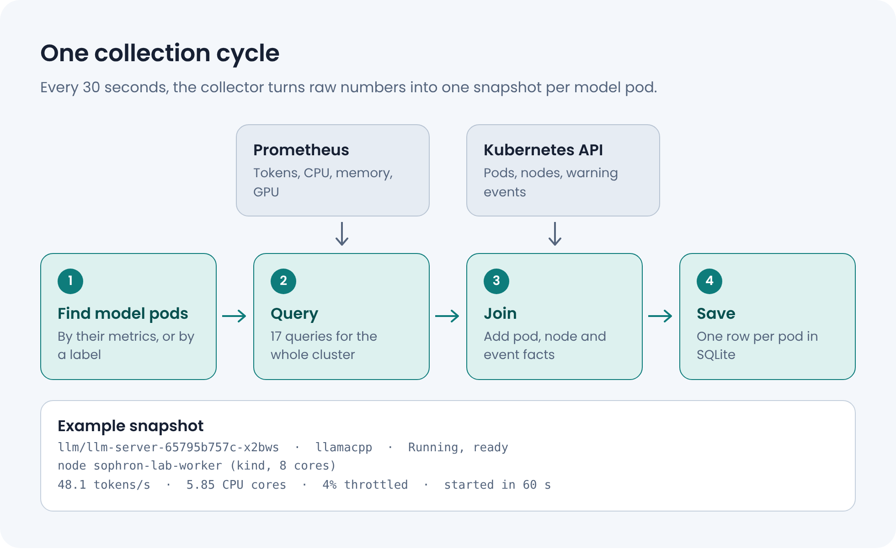

# Phase 2: Collector

## What we built

Sophron's first code: a Go program that runs in the cluster and, every 30 seconds, saves one snapshot per model pod.

| Part | File | Job |
|---|---|---|
| Entry point | `cmd/collector/main.go` | Wires everything, handles shutdown |
| Settings | `internal/config` | Flags with env var defaults |
| Metric mapping | `internal/mapping/default.yaml` | Which PromQL means what, per model server |
| Prometheus client | `internal/prom` | Instant queries over the HTTP API |
| Kubernetes cache | `internal/kube` | Informers for pods, nodes, warning events |
| Collector | `internal/collector` | Find, query, join, build snapshots |
| Store | `internal/store` | SQLite, one row per pod per cycle |
| API | `internal/api` | `/healthz`, `/readyz`, snapshots as JSON |
| Image | `Dockerfile` | Two stages, distroless, non-root |
| Deploy | `deploy/collector/collector.yaml` | RBAC, PVC, Deployment, Service |
| CI | `.github/workflows/ci.yml` | Tidy, format, vet, lint, test, image, manifests |

## How one cycle works

1. **Find model pods**, two ways:
   - Pods exposing a known metric, such as `llamacpp:tokens_predicted_total`. No setup needed.
   - Pods labelled `sophron.dev/model-server`. This catches pods that are Pending and have no metrics yet.
2. **Query Prometheus** once per metric for the whole cluster, grouped `by (namespace, pod)`. 17 queries whether you run 1 model or 500.
3. **Join** each pod's numbers with facts from the informer cache: node type, restarts, last crash reason, latest warning event.
4. **Save** the batch to SQLite in one transaction.

## Key ideas

### Informers

| Without informers | With informers |
|---|---|
| Every cycle LISTs all pods from the API server | One LIST at start, then a WATCH stream of changes |
| Load on the API server grows with every tool | Reads come from local memory, zero API calls |

That's how every Kubernetes controller works, including the ones inside Kubernetes itself. We use a field selector `type=Warning` on events, so Normal events never fill our memory.

### Labels as the join key

Prometheus attaches `namespace` and `pod` labels to every series it scrapes. Kubernetes knows pods by namespace and name. Matching the two is the join. You saw this in Grafana in Phase 1: the token metric had no `node` label, but the CPU metric did.

### "No data" is not zero

Metric fields are pointers in Go (`*float64`) and `NULL` in SQLite. A CPU-only node has no GPU metrics. Storing `0` would look like an idle GPU and trigger a false "waste" alert later.

### Fail soft

| If this breaks | The collector |
|---|---|
| One query fails | Logs it, leaves that value empty, keeps going |
| Prometheus is down | Still records labelled pods from Kubernetes (exactly when you need it) |
| Kubernetes API is down | Fails the cycle, `/readyz` turns red |

### Liveness vs readiness

- `/healthz`: is the process alive? If not, Kubernetes restarts it.
- `/readyz`: are caches synced, is the database OK, did a cycle succeed in the last 90 seconds?

### Least privilege

The ServiceAccount can only `get`, `list` and `watch` pods, nodes and events. It can't read Secrets or change anything. The container runs as user 65532, with a read-only root filesystem and all Linux capabilities dropped.

### Why SQLite, why pure Go

One file, no database server to run. The driver (`ncruces/go-sqlite3`) is pure Go, so the binary builds with `CGO_ENABLED=0` and runs on a distroless image with no shell or package manager.

### Recreate, again

Two collector pods would both write to the same SQLite file. `strategy: Recreate` stops the old one first, the same lesson as the model server in Phase 1.

### Two-stage Docker build

| Stage | Contains | Size |
|---|---|---|
| `golang:1.27` | Compiler, source, module cache | Over 800 MB |
| `distroless/static:nonroot` | Our binary only | About 36 MB (34 MB binary, 2 MB base) |

The dependency download gets its own layer, so changing code doesn't re-download modules.

### CI as the safety net

| Step | Catches |
|---|---|
| `go mod tidy` + diff | Forgotten or unused dependencies |
| `gofmt` | Unformatted code |
| `go vet`, golangci-lint | Bugs and bad patterns |
| `go test -race` | Failing tests and data races |
| Docker build | A broken image |
| kubeconform | Invalid Kubernetes YAML |

## Commands

| Command | Does |
|---|---|
| `make test` | Unit tests with the race detector |
| `make collector-up` | Build the image, load it into kind, deploy |
| `make collector-check` | Phase 2 checks |
| `make collector-snapshots` | Latest snapshot of every model pod |
| `make collector-status` | Last cycle: time, pods, failed queries |
| `make collector-logs` | Follow the logs |

## Real-world examples

- **kube-state-metrics** and **OpenCost** use the same informer pattern
- **Prometheus Adapter** joins Prometheus series to pods by `namespace` and `pod` labels, just like our join
- **Distroless + non-root + read-only root FS** is the default hardening for many production images

## Interview questions you can now answer

- What is an informer and why not just LIST every 30 seconds?
- How do you join Prometheus metrics with Kubernetes objects?
- Liveness vs readiness: what should each one check?
- Why use pointers or NULL for missing metrics?
- What's in a minimal RBAC role for a read-only agent?
- Why a two-stage Docker build? Why distroless?
- Your agent depends on Prometheus. What happens when Prometheus is down?
