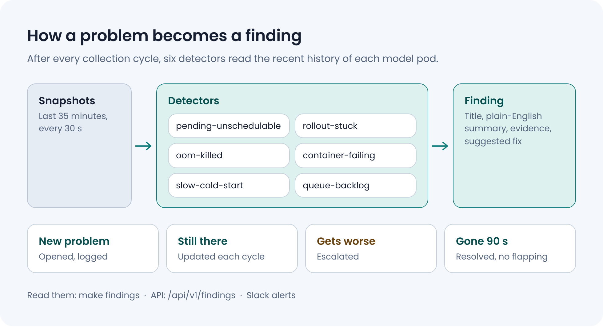

# Phase 3: Rules engine

---

## ***Overview***

The collector (Phase 2) records what is happening. The rules engine decides **what is wrong**.

After every 30-second collection cycle, six detectors read each model pod's recent history and report known LLM-serving problems as **findings**: a one-line title, a plain-English summary, the evidence, and a suggested fix with real values filled in.

> No AI is involved. Detectors are small Go functions: free, offline, testable, and they never invent an action. An LLM can explain findings later (Phase 7), but it will never decide what to do.

---

## ***What we built***

| Part | File | Job |
|---|---|---|
| Finding and Fix types | `internal/rules/finding.go` | What a problem report looks like |
| Detector framework | `internal/rules/input.go`, `detectors.go` | Thresholds, history helpers, the detector list |
| Scheduling detectors | `internal/rules/scheduling.go` | `pending-unschedulable`, `rollout-stuck` |
| Crash detectors | `internal/rules/crash.go` | `oom-killed`, `container-failing` |
| Serving detectors | `internal/rules/serving.go` | `slow-cold-start`, `queue-backlog` |
| Engine | `internal/rules/engine.go` | Runs detectors, opens / updates / resolves findings |
| Findings table | `internal/store/findings.go` | Findings in SQLite, one open row per problem |
| Schema migration | `internal/store/store.go` | Adds new snapshot columns to old databases |
| API | `internal/api/server.go` | `/api/v1/findings`, `/api/v1/detectors`, `/api/v1/rules/status` |
| Chaos scenarios | `lab/scripts/chaos.sh` | Breaks the lab on purpose, six ways |
| End-to-end check | `lab/scripts/check-rules.sh` | Runs every scenario, checks the right detector fires |

New snapshot facts the detectors needed:

| Field | Why |
|---|---|
| `revision` | Two revisions of one workload at once means a rollout is in progress |
| `createdAt` | A Pending pod has no start time; creation time is the only way to know how long it has waited |
| `startedAt`, `readyAt` | How long a start took, and whether it was recent |

---

## ***How it works***

1. The collector saves this cycle's snapshots, then calls the engine (`AfterCycle` hook).
2. The engine loads the last 35 minutes of snapshots in **one** query and groups them per pod.
3. Every detector gets the same `Input`: this cycle's snapshots plus each pod's history.
4. Findings get a stable **key**: `detector/namespace/workload`. A crashing pod that is replaced by a new pod name is still the same problem.
5. The engine compares with the open findings in the database:

| Situation | What the engine does |
|---|---|
| New key | Inserts an open finding, logs `finding opened` |
| Key still reported | Updates evidence and `lastSeen` |
| Severity went up | Updates and logs `finding escalated` |
| Not reported for 90 s | Resolves it, logs `finding resolved` |
| Same problem returns later | Opens a **new** finding, so history stays honest |

> The 90-second wait before resolving stops "open, resolve, open" flapping when a problem blinks for one cycle.

---

## ***The six detectors***

| Detector | Catches | Severity | Suggested fix |
|---|---|---|---|
| `pending-unschedulable` | Pod has no node for 2+ min. Reads the scheduler message: GPU, CPU, memory, selector, taint, storage | Critical if nothing else serves | Specific to the cause, for example `kubectl set resources ... --requests=cpu=2` |
| `rollout-stuck` | New version not Ready for 3+ min while the old one serves | Warning | If there's no room for both: `maxSurge: 0` or `Recreate`. Otherwise fix or `rollout undo` |
| `oom-killed` | Container killed for exceeding its memory limit, recently | Critical if not Ready | New limit = max(limit × 1.5, peak × 1.3). For llama.cpp: lower `--ctx-size` / `--parallel` |
| `container-failing` | CrashLoopBackOff, 2+ restarts in 15 min, image pull or create errors | Critical if not Ready | `kubectl logs --previous`, common LLM causes listed |
| `slow-cold-start` | Still starting after 2 min, or a recent start that took over 2 min | Warning / Info | Keep the model on a volume or in the image, pre-pull images, faster disk |
| `queue-backlog` | Requests waiting for a free slot, 3 snapshots in a row | Warning | Checks CPU/GPU first. Busy hardware: add a replica. Idle hardware: raise `--parallel` |

---

## ***Key ideas***

### One root problem, one finding

During a stuck rollout the new pod is also Pending. Two findings for one problem is noise, so `pending-unschedulable` skips pods that belong to a rollout, and `rollout-stuck` explains the scheduling cause itself. Likewise `container-failing` skips OOM crashes, because `oom-killed` explains them better.

### Several signals before advice

`queue-backlog` is the Phase 1 lesson in code. "Requests are waiting" alone suggests "add slots". But if the CPU is already at its limit, more slots share the same cores, so the advice changes to "add capacity".

### Thresholds avoid false alarms

| Without a threshold | With one |
|---|---|
| Every pod is Pending for a few seconds at start: alert | Only Pending for 2+ min |
| One request waited once: alert | Waiting 3 snapshots in a row (~90 s) |
| An OOM from yesterday: alert forever | Only if it restarted in the last 30 min |

### A buggy detector can't break the engine

Each detector runs inside `recover()`. If one panics, it's logged and skipped; the others still run. There's a test for exactly that.

### Detectors are pure functions

Input in, findings out. No database, no network, no clock (the time comes in `Input.Now`). That's why each one can be tested with a few hand-made snapshots.

### Chaos testing

We break the lab on purpose in ways that happen in real clusters, then check the right detector fires:

| Scenario | What we break | Real-world version |
|---|---|---|
| `oom` | `--ctx-size 32768` with a 512 Mi limit (~900 MiB KV cache) | Someone raises the context window |
| `crash` | Model path points to a missing file | A typo in the model name |
| `gpu` | Request `nvidia.com/gpu: 1` | GPU node pool missing or full |
| `rollout` | RollingUpdate with `maxSurge: 1` on a full node | Our Phase 1 stuck rollout |
| `slow-start` | Init container sleeps 210 s | Downloading the model on every start |
| `queue` | `--parallel 1` with 4 clients | Too few slots for the traffic |

---

## ***Commands***

| Command | Does |
|---|---|
| `make findings` | Open findings |
| `make findings-all` | Open and resolved |
| `make detectors` | What each detector looks for |
| `make chaos-list` | The scenarios |
| `make chaos SCENARIO=oom` | Break one thing |
| `make chaos-reset` | Put it back |
| `make rules-check` | All scenarios, PASS/FAIL (~25 min). One only: `make rules-check SCENARIOS=oom` |

---

## ***Real-world examples***

| Tool | Same idea |
|---|---|
| Prometheus alerting rules | Conditions with a `for:` duration, like our thresholds |
| Kubernetes Event Exporter, Robusta | Turn Kubernetes events into readable alerts |
| K8sGPT | Analyzers per resource type, each a small rule, like our detectors |
| Netflix Chaos Monkey | Break things on purpose to prove you detect and survive them |

---

## ***Interview questions you can now answer***

- How do you stop an alert from flapping?
- How do you avoid five alerts for one root cause?
- Why should detection rules be deterministic before you add AI?
- A pod is OOMKilled. What do you check, and how do you pick the new limit?
- A rollout is stuck with the old version still serving. What are the usual causes?
- What does chaos testing prove that unit tests can't?
- How do you add a column to a live SQLite database without losing data?

---

> **Issues Faced & Resolutions**
>
> | Issue | Resolution |
> |---|---|
> | A Pending pod has no start time, so we couldn't tell how long it had waited | Added `createdAt` (pod creation time) to snapshots |
> | Existing Phase 2 databases lack the new columns | `migrate()` checks `pragma_table_info` and runs `ALTER TABLE ... ADD COLUMN` for missing ones; tested by dropping columns and reopening |
> | Not sure what llama.cpp's `requests_deferred` counts | Read the server source: a task is deferred when no slot is free, so it is the waiting queue |
> | `kubectl apply` can't remove fields it never set (a GPU limit or `rollingUpdate` added by a patch) | `chaos reset` removes those with a JSON patch first, then applies the manifest |
> | The slow-start check could miss the short "still starting" window (~40 s) between polls | Fake download raised to 210 s, and the check accepts either the "still starting" or the "took ... to start" title |
> | staticcheck flagged an unused helper | Removed it |
> | In the lab, the crash finding said "keeps crashing (0 restarts in 15m)" | The new pod crashed before our first snapshot of it, so "restarts now minus lowest seen" was 0. A pod created inside the window started at 0, so we use its total. Added a test |
{.is-danger}

> **Useful Links**
>
> - [Pod lifecycle and container states](https://kubernetes.io/docs/concepts/workloads/pods/pod-lifecycle/)
> - [Deployment strategies: Recreate and RollingUpdate](https://kubernetes.io/docs/concepts/workloads/controllers/deployment/#strategy)
> - [Resource requests and limits](https://kubernetes.io/docs/concepts/configuration/manage-resources-containers/)
> - [llama.cpp server](https://github.com/ggml-org/llama.cpp/tree/master/tools/server)
> - [Google SRE book: Monitoring distributed systems](https://sre.google/sre-book/monitoring-distributed-systems/)
> - [Principles of chaos engineering](https://principlesofchaos.org/)
{.is-info}

-----
