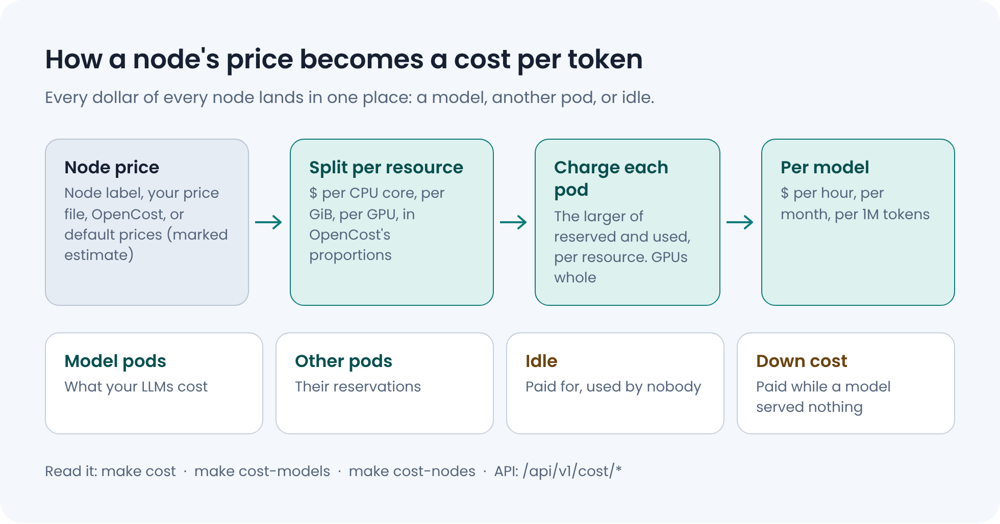

# Phase 4: Cost engine



---

## ***Overview***

The collector knows what each model does. The cost engine says **what it costs**: per hour, per month, per million tokens, and how much of every node is paid for but used by nobody.

Every 30-second snapshot now carries the pod's cost. The API adds it up per model, per node and for the whole cluster.

> Sophron's angle is not a better cost number than OpenCost. It's joining cost with health: a finding now says what the outage cost, and (next) every suggested fix will say what it saves.

---

## ***What we built***

| Part | File | Job |
|---|---|---|
| Price file | `internal/cost/pricing.go` | Node prices, owned hardware, reference APIs (YAML, strict) |
| Pricer | `internal/cost/pricer.go` | Price each node, split it per resource, charge each pod |
| Reports | `internal/cost/report.go` | Per model, per node, cluster summary |
| Snapshot fields | `internal/collector/snapshot.go`, `internal/store/store.go` | `costPerHour`, `nodeCostPerHour`, `priceSource`, `memoryRequestBytes`, `nodeRegion` (migrated) |
| Node facts | `internal/kube/kube.go` | Region, labels, price label, `Nodes()`, `NodeRequests()` |
| Down cost | `internal/rules/resolution.go` | What a model cost while it served nothing |
| API | `internal/api/server.go` | `/api/v1/cost/summary`, `/cost/models`, `/cost/nodes` |
| Lab prices | `deploy/collector/collector.yaml` | `sophron-pricing` ConfigMap, mounted read-only |
| Lab check | `lab/scripts/check-cost.sh` | Sends load, checks prices, the split and cost per token |

---

## ***How a node gets its price***

The first source that has a price wins:

| # | Source | When to use it |
|---|---|---|
| 1 | Node label or annotation `sophron.dev/hourly-price: "0.42"` | One-off nodes, quick fixes |
| 2 | Price file rule (name pattern and/or labels) | Your negotiated prices, on-prem, the lab |
| 3 | OpenCost's `node_total_hourly_cost` metric | OpenCost already installed: we reuse its cloud prices |
| 4 | Default unit prices × node size | Nothing else: marked **estimate** everywhere it shows |

Owned hardware in the price file:

```yaml
nodes:
  - match: { node.kubernetes.io/instance-type: rtx-4090-box }
    owned: { purchasePrice: 3200, lifetimeYears: 3, powerWatts: 450, electricityPerKWh: 0.12, pue: 1.2 }
```

Hourly = purchase price ÷ hours in its life + kW × electricity price × PUE.

> No guessed cloud price table ships with Sophron. Cloud prices change and differ per region and discount; a wrong built-in price is worse than an honest "estimate".

---

## ***How a pod is charged***

1. **Split the node price** into $ per CPU core, per GiB and per GPU, in the same proportions as OpenCost's default prices. A GPU node's price lands mostly on its GPUs.
2. **Charge the larger of reserved and used**, per resource. Reserve 4 cores and use 6: you pay for 6. Reserve 3 GiB and use 1: you pay for 3.
3. **GPUs are charged whole.** A GPU can't be half-reserved without MIG or time-slicing.
4. **Pending pods cost nothing yet**: no node, no bill.

On every node: **model pods + other pods + idle = node price.** Other pods pay for what they reserved; whatever is left is idle.

---

## ***The numbers***

| Number | How | Where |
|---|---|---|
| Cost per hour | Sum of the model's pods in the latest cycle | `make cost-models` |
| Month forecast | Cost per hour × 730 | Same |
| Cost per 1M output tokens | Cost in the window ÷ output tokens in the window × 10⁶ | Same, `WINDOW=1h` |
| Cost per 1M tokens | Same with input + output | Same |
| Cost per 1M output tokens while busy | Only cycles producing tokens (≥ 0.5/s). The gap to the average is what idle time costs | Same (`costPer1MOutputTokensBusy`, `busyShare`) |
| Capacity used | Output tokens/s now ÷ the highest seen in 7 days | Same |
| Idle | Node price − model pods − other pods | `make cost-nodes` |
| Down cost | Cost while no pod of the workload was Ready, while the finding was open | Resolved findings, Slack |
| API comparison | This month's tokens at the API's prices vs self-hosting; break-even tokens per month | `make cost-models` (needs `referenceAPIs`) |

Each snapshot counts for the time until the same pod's next snapshot, capped at 2 minutes, so a collector restart isn't billed as one long snapshot.

---

## ***The lab, by hand***

The EC2 t3.2xlarge costs $0.3328/hour. Its three kind nodes are containers on that one machine, and each sees all 8 cores and ~31 GiB, so the price file gives each a third: **$0.1109/hour**.

Under load, llama.cpp uses ~5.85 cores and reserves 3 GiB:

| Step | Value |
|---|---|
| Node at default prices | 8 × 0.031611 + 31.3 × 0.004237 = $0.3855 |
| Scale to the real price | 0.1109 ÷ 0.3855 = 0.288 |
| Pod at default prices | 5.85 × 0.031611 + 3 × 0.004237 = $0.1976 |
| Pod cost per hour | 0.1976 × 0.288 ≈ **$0.057** |
| Tokens per hour | 48 tokens/s × 3,600 = 172,800 |
| Cost per 1M output tokens | 0.057 ÷ 0.1728 ≈ **$0.33** |

When idle, the pod uses little CPU, so it pays for its 4 reserved cores: about $0.040/hour.

First lab run (`make cost-check`, 15 min window, mostly idle after the load test): **$0.0519/hour** under load, $0.040/hour idle, **$0.97 per 1M output tokens** on average, cluster $0.3327/hour with 80% idle. Close to the hand estimate; the per-token figure is higher because the window includes idle minutes, which is what the busy-time number now separates.

---

## ***Key ideas***

### Reserved vs used

Kubernetes schedules by **requests**, so a reservation blocks other pods even if unused. Usage above the request takes spare capacity. Charging the larger of the two is fair both ways, and it's what OpenCost does.

### Idle cost is the easiest saving

Idle is money spent on capacity nobody reserved. Big idle shares mean the node is too big, or a pool scaled up and never down.

### Estimates must look like estimates

A price from defaults is flagged `estimate: true`, listed in the model's `notes`, and counted in the summary's `estimatedNodes`. A dashboard showing "$0" or a confident wrong number is how teams lose trust in cost tools.

### Down cost joins health and money

A crash-looping model still holds its node. "OOM loop for 12 minutes" becomes "OOM loop: $0.07 for nothing", a number a manager can weigh against the fix.

---

## ***Commands***

| Command | Does |
|---|---|
| `make cost` | Spend per hour and month, idle share, cost per 1M tokens (`WINDOW=24h`) |
| `make cost-models` | Per model: cost, tokens, capacity used, API comparison, notes |
| `make cost-nodes` | Per node: price and source, model pods, other pods, idle |
| `make cost-check` | Phase 4 check in the lab: load, prices, split adds up, cost per token |

---

## ***Real-world examples***

| Tool | Same idea |
|---|---|
| [OpenCost](https://www.opencost.io/docs/specification) | The allocation method: max(request, usage) × unit prices, idle as its own line |
| [OpenCost inference cost (1.121)](https://www.cncf.io/blog/2026/08/05/opencost-1-121-0-first-of-a-kind-kubernetes-inference-cost-tracking/) | Cost per million tokens per model, for vLLM / llm-d |
| [InferCost](https://dev.to/defilan/the-0-problem-why-every-tool-says-your-on-prem-inference-is-free-3mcb) | Owned GPUs: purchase price over lifetime plus power |
| Cloud bills (AWS CUR, GCP billing export) | 730 hours per month, the source of truth to reconcile with |

---

## ***Interview questions you can now answer***

- How do you split a node's cost between the pods on it?
- Why charge max(request, usage) and not just usage?
- How do you work out cost per 1,000 tokens for a self-hosted model?
- When is self-hosting cheaper than an API? What is the break-even point?
- What is idle cost and how do you reduce it?
- How do you price on-prem GPUs you already bought?
- How do you stop a cost tool from showing confident wrong numbers?

---

> **Issues Faced & Resolutions**
>
> | Issue | Resolution |
> |---|---|
> | Snapshots had memory limits but not memory requests, and cost needs requests | Added `memoryRequestBytes` to pods, snapshots and the database (migrated) |
> | The three kind nodes each report the whole host's 8 cores, so pricing each as a full t3.2xlarge would triple the bill | The lab price file gives each node a third of the EC2 price |
> | Couldn't verify a cloud price table from here, and stale built-in prices mislead | No built-in table: node label, price file, OpenCost, then defaults marked as estimates |
> | Averaging cost per token over snapshots would weight a quiet minute like a busy one | Sum cost and tokens over the window with the same time weights, then divide |
> | A gap in collection (restart) would count as one very long snapshot | Each snapshot counts for at most 2 minutes |
> | Idle could go negative when model pods use more than they reserved | Other pods are capped at what's left; idle is never below 0, and model + other + idle always equals the node price (tested) |
> | The first lab run showed $0.97 per 1M "at 4.2 tokens/s": an average over a window that was mostly idle, so a token looked 3× dearer than it is while serving | Added cost per 1M while busy and the busy share, and the check now labels the average as "idle time included" |
> | Every `/cost/models` call loaded 7 days of snapshots just to find the peak, which gets slow as history grows | SQLite computes the per-cycle peak (`OutputPeaks`); the API loads only the report window |
> | The node report listed every pod once per node | `AllNodeRequests` adds up all nodes in one pass |
> | A typo in the price file (`node:` instead of `nodes:`) would silently price nothing | Strict YAML: unknown keys are errors; rules without a match or price are rejected |
{.is-danger}

> **Useful Links**
>
> - [OpenCost specification](https://www.opencost.io/docs/specification)
> - [OpenCost 1.121: inference cost tracking](https://www.cncf.io/blog/2026/08/05/opencost-1-121-0-first-of-a-kind-kubernetes-inference-cost-tracking/)
> - [Tokenomics of self-hosted LLMs (Red Hat)](https://developers.redhat.com/articles/2026/08/19/tokenomics-self-hosted-llms)
> - [Resource requests and limits](https://kubernetes.io/docs/concepts/configuration/manage-resources-containers/)
> - [EC2 t3.2xlarge pricing](https://spendark.com/instances/t3-2xlarge/)
{.is-info}

-----
