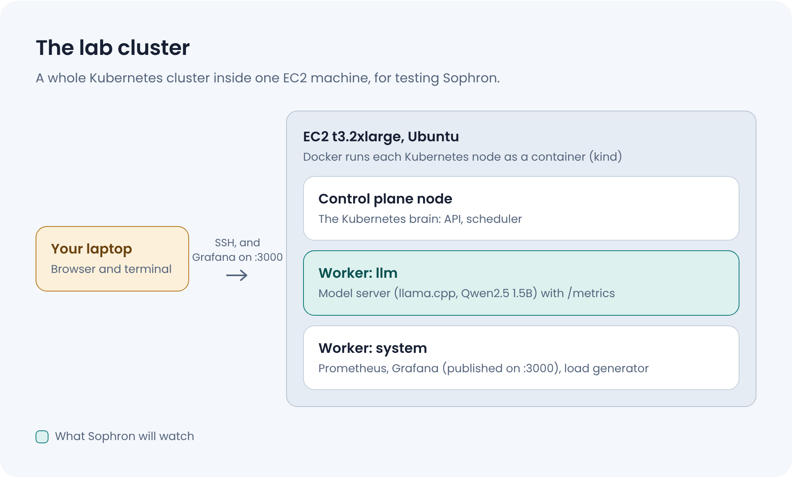

# Lab cluster



A throwaway Kubernetes cluster that runs a real LLM, so Sophron has something to watch and break.

| What | Details |
|---|---|
| Cluster | kind: 1 control plane + 2 workers, as Docker containers |
| Model | Qwen2.5 1.5B Instruct (4-bit), served on CPU by llama.cpp |
| Monitoring | Prometheus + Grafana (kube-prometheus-stack) |
| Load | A Job with 4 workers sending chat requests |
| Machine | Ubuntu, 8 vCPU, 32 GB RAM, 40 GB+ disk (we use an EC2 t3.2xlarge) |

## 1. Prepare the EC2 instance

- Security group: allow port 22 from **your IP only**. Open nothing else.
- Start the instance and note its public IP. It changes after every stop/start.

```bash
ssh -i ~/.ssh/<your-key>.pem ubuntu@<public-ip>
```

## 2. Get the code

The repo is private, so use a GitHub token (fine-grained, read-only, `sophron` repo only):

```bash
git clone https://github.com/Shiva-2103/sophron.git
cd sophron
git switch phase-1/kind-lab
```

## 3. Install tools (once)

```bash
make lab-tools        # Docker, kind, kubectl, helm (asks for sudo)
newgrp docker         # use Docker without sudo in this shell
```

## 4. Start the lab

```bash
make lab-up           # about 5 to 10 minutes the first time
make lab-check        # PASS/FAIL for each Phase 1 goal
```

## 5. Send traffic and watch the metrics

```bash
make lab-load         # 4 workers x 25 requests
make lab-check        # tokens per second should now be above 0
```

## 6. Open Grafana from your laptop

Grafana is always published on port 3000 of the EC2 instance. No port-forward needed.

```bash
make lab-grafana-allow-me   # opens port 3000 in the security group, for your IP only
make lab-grafana            # prints the URL and the admin password
```

Then browse to `http://<ec2-public-ip>:3000` (user `admin`).

| How it works | |
|---|---|
| `lab/kind/cluster.yaml` | Maps port 3000 on the instance to port 30000 in the kind control-plane container |
| `lab/monitoring/values.yaml` | Grafana's Service is a NodePort on 30000 |
| `make lab-grafana-allow-me` | Adds a security group rule for the IP you SSH'd in from (`/32`) |

> Never open port 3000 to `0.0.0.0/0`. Grafana is plain HTTP here.
> Your home IP can change. If Grafana stops loading, run `make lab-grafana-allow-me` again, and `make lab-grafana-revoke-me` to remove an old rule.

Prometheus and the model API stay private. Reach them through an SSH tunnel:

```bash
# on the instance
make lab-ports

# on your laptop
ssh -i ~/.ssh/<your-key>.pem -N -L 9090:localhost:9090 -L 8080:localhost:8080 ubuntu@<public-ip>
```

Try this query in Grafana (Explore) or Prometheus: `rate(llamacpp:tokens_predicted_total[1m])`

## 7. Run the Sophron collector (Phase 2)

```bash
make collector-up        # build the image, load it into kind, deploy
make lab-load            # create some traffic
make collector-check     # PASS/FAIL for each Phase 2 goal
make collector-snapshots # the latest snapshot as JSON
```

The first build downloads Go modules and takes a few minutes. Later builds reuse the cache.

## 8. Break things on purpose (Phase 3)

The collector now runs six detectors after every cycle. Break the model server and watch it get caught:

```bash
make chaos-list               # the six scenarios
make chaos SCENARIO=oom       # break one thing
make findings                 # what Sophron found (give it a minute or two)
make chaos-reset              # put it back
make rules-check              # all six, automatic PASS/FAIL (~25 min)
```

Rebuild the collector first if it's older than Phase 3: `make collector-up`.

## 9. Get alerts in Slack (Phase 3)

1. In Slack: [api.slack.com/apps](https://api.slack.com/apps) → **Create New App** → **From scratch** → name `Sophron`, pick your workspace.
2. **Incoming Webhooks** → turn **On** → **Add New Webhook** → pick a channel (e.g. `#sophron-alerts`) → **Allow** → copy the URL.
3. On the lab machine:

```bash
make slack-secret     # paste the URL into the hidden prompt; it becomes a Kubernetes Secret
make slack-test       # a sample alert appears in the channel
make chaos SCENARIO=oom   # a real one, about a minute later; make chaos-reset and a green "resolved" follows
```

> The webhook URL is a password. Never paste it into chat, a file or Git. Lost it or leaked it? Delete the webhook in the Slack app page and make a new one. `make slack-off` stops alerts.

## 10. See what it costs (Phase 4)

```bash
make collector-up     # rebuild with the cost engine
make cost-check       # sends load, then checks prices and cost per token (~3 min)
make cost             # the cluster at a glance
make cost-models      # per model: $/hour, $/month, $ per 1M tokens, capacity used
make cost-nodes       # per node: price, model pods, other pods, idle
```

The lab's price lives in the `sophron-pricing` ConfigMap in `deploy/collector/collector.yaml`: the EC2 price split over the three kind nodes. Edit `referenceAPIs` there to compare with APIs you know the prices of.

## 11. Open the dashboard and approve a fix

```bash
git pull && make collector-up   # rebuild with the dashboard, fixes and policy
make admin-password             # once: prints the admin and viewer passwords
make dashboard-allow-me         # opens port 8081 in the security group for your IP only
make dashboard                  # serves it at http://<public-ip>:8081
make e2e-check                  # break → alert → approve → fixed → receipt (~5-15 min)
```

`make dashboard` keeps serving when the collector restarts, and allows sign-in over plain http (lab only). Prefer no open port? `make dashboard-private` serves it on the machine only and prints the SSM port-forward command for your laptop.

No cluster? `make demo` runs the same dashboard on sample data at http://localhost:8090 (admin / demo-password-1).

## Commands

| Command | Does |
|---|---|
| `make lab-up` | Create everything |
| `make lab-check` | Check the Phase 1 goals |
| `make lab-load` | Send requests (`REQUESTS=100` for more) |
| `make lab-status` | Show nodes and pods |
| `make lab-grafana` | Grafana URL and password |
| `make lab-grafana-allow-me` / `revoke-me` | Open or close port 3000 for your IP |
| `make lab-ports` / `lab-ports-stop` | Open or close Prometheus and model API ports |
| `make lab-down` | Delete the cluster |
| `make collector-up` / `collector-check` | Deploy and check the collector |
| `make collector-snapshots` / `collector-logs` | See what it collected |
| `make findings` / `detectors` | Problems found / what each detector checks |
| `make chaos SCENARIO=...` / `chaos-reset` | Break the model server on purpose / undo |
| `make rules-check` | Phase 3 check, all scenarios |
| `make cost` / `cost-models` / `cost-nodes` / `cost-check` | What it costs; Phase 4 check |
| `make admin-password` / `dashboard` / `dashboard-stop` | Dashboard logins / serve it on public port 8081 / stop |
| `make dashboard-allow-me` / `dashboard-revoke-me` / `dashboard-private` | Open or close 8081 for your IP / serve via SSM only |
| `make doctor` / `savings` / `fixes` / `e2e-check` | Setup checks / savings / fix requests / the full loop |
| `make slack-secret` / `slack-test` / `slack-off` | Store the Slack webhook / send a sample alert / stop alerts |

## Save money

Stop the EC2 instance when you're done. You pay per hour while it runs. The cluster comes back with `make lab-up` after a restart (kind containers don't survive a reboot cleanly, so `make lab-down && make lab-up` if anything looks stuck).

## If something fails

| Symptom | Try |
|---|---|
| `permission denied ... docker.sock` | `newgrp docker`, or log out and back in |
| Model pod stuck in `Init` | `kubectl -n llm logs deploy/llm-server -c download-model` (model download) |
| Model pod `CrashLoopBackOff` | `kubectl -n llm logs deploy/llm-server` |
| `up=0` in lab-check | Wait 30 seconds, Prometheus scrapes every 15 seconds |
| Pods `Pending` | `kubectl describe pod ...` and look at Events at the bottom |
| Grafana not on port 3000 | Cluster is older than the port mapping: `make lab-down && make lab-up` |
| Grafana times out from the laptop | Security group: `make lab-grafana-allow-me` (your IP may have changed) |
